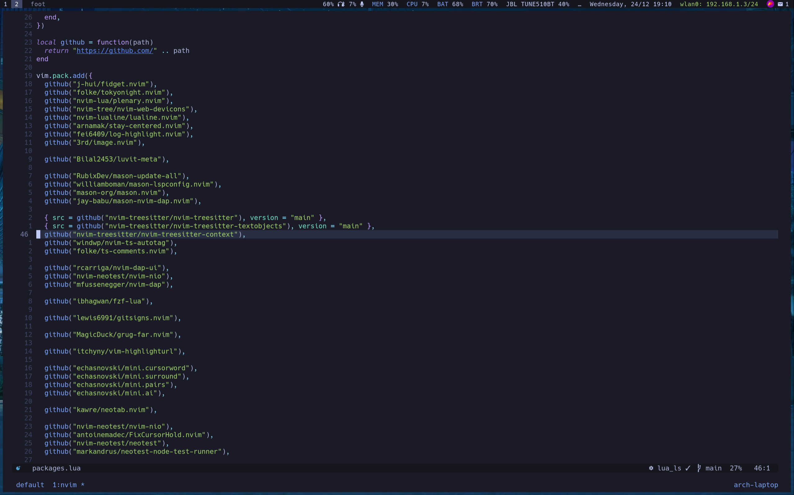
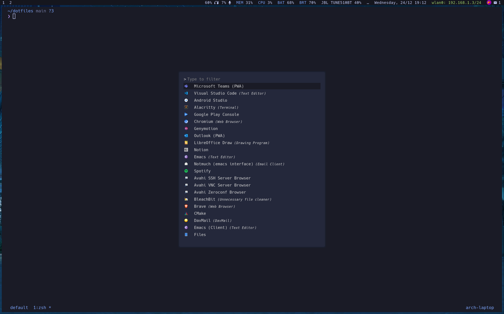
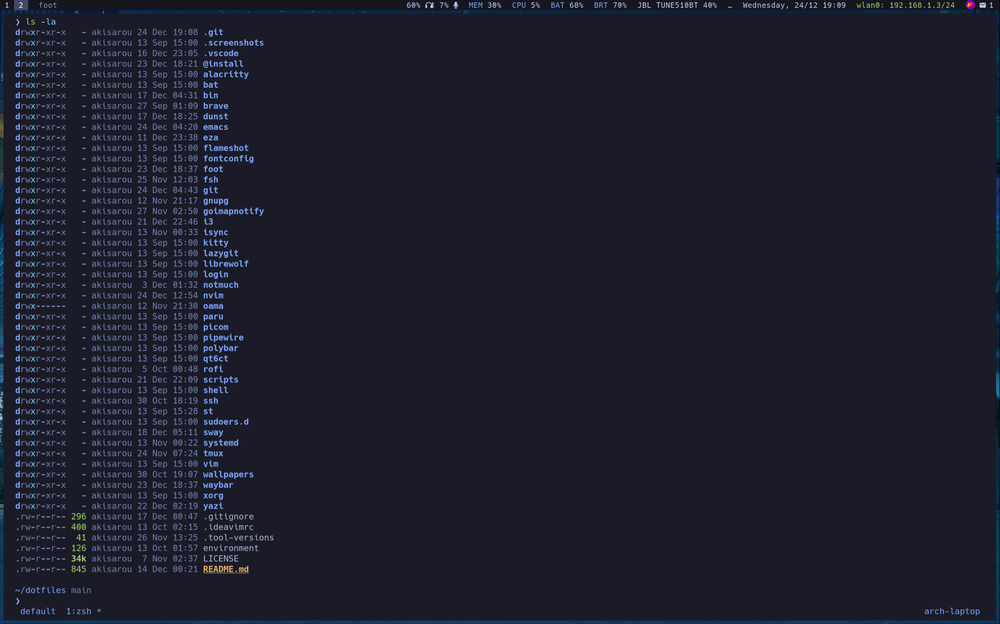

# akisarou dotfiles

This is the configuration of my Arch linux and other useful programs

## Packages

Wayland

- WM: sway
- Bar: waybar
- Terminal: foot

X11

- WM: i3
- Bar: polybar
- Terminal: st

Common

- Editor:
  nvim,
  vim (minimal config),
  vscode (configuration at .vscode)
- Browsers: brave, librewolf
- Terminal: alacritty, kitty
- Filemanager: nautilus
- Notifications: dunst
- Shell: zsh
- Screenshot: flameshot

Also:

- git config
- fzf, fd, rg
- various helper scripts

## Codex

`codex/config.toml` contains shared defaults and is symlinked to
`/etc/codex/config.toml`. Codex reads those defaults automatically; local settings
in `~/.codex/config.toml` take precedence. Project trust, UI state, and model
changes stay in that regular user file, outside this repository.

Run `zsh ~/dotfiles/codex/install` to apply this setup on its own, or run the
usual `@install/3-dotfiles` installer. It needs sudo to install the system symlink
and preserves an existing user config, converting an old symlink into a regular
file. Themes remain symlinked separately by the main installer.

Edit the tracked config to change defaults. If the user config contains the same
key, remove it there to inherit the default again. An old symlink's contents are
preserved in full during migration, so it may initially contain duplicate
defaults. No user config needs to be copied on a fresh install.

## Claude Code

`claude/settings.json` contains portable defaults. Run
`zsh ~/dotfiles/claude/install` to apply them, or run `@install/3-dotfiles`.
The zsh installer uses Python's standard JSON library; no additional packages
or sudo are needed for Claude.

`~/.claude/settings.json` stays a regular, mutable file. The installer compares
it with the previously applied defaults in
`~/.local/state/dotfiles/claude/settings.json`: unchanged defaults follow edits
in this repository, while local overrides, deleted keys, edited lists, and
unrelated settings are preserved. On a first install, existing preferences win
and missing defaults are added. Removing a default from the repository removes
its local value only if it was still inherited. Changed settings are backed up
before an atomic replacement; rerunning an unchanged install leaves them alone.
To adopt a default you previously overrode, copy that value from the tracked
file into your local settings.

Generated `autoMode.environment` context and dismissed prompts stay local.
`~/.claude.json`, credentials, sessions, and per-project settings stay outside
this repository. `claude/mcp.json` tracks MCP definitions; the installer
registers changes through `claude mcp` with user scope and preserves locally
modified or unrelated servers. It keeps the MCP baseline alongside the settings
baseline. `CLAUDE_CONFIG_DIR` and `XDG_STATE_HOME` are respected; custom Claude
config directories receive separate baselines under the state directory.

## Waybar AI usage

The robot module uses `waybar/ai-usage.py` to fetch Claude, OpenAI/Codex,
and Meta/Muse subscription usage directly. Hover for weekly usage bars, remaining
allowance, reset countdowns and local reset dates. OpenAI also shows available
reset credits and their expiry when reported. Click for a terminal summary.
It uses Python's standard library.

Sign in with the provider CLIs first. The script reads their existing login
files and leaves token refresh to the CLIs; reopen the relevant CLI if its
login expires. `CLAUDE_CONFIG_DIR`, `CODEX_HOME`, `MUSE_AUTH_PATH`, and the XDG
config/cache directories are respected. Muse needs a browser/device login
for subscription usage.

Usage is cached for five minutes under `~/.cache/waybar-ai-usage`. Failed
requests retain the last successful usage, marked as cached. Cache files
contain only normalized quota data and a login fingerprint. Fable is omitted.

Run `python3 ~/.config/waybar/ai-usage.py --pretty` for the terminal summary,
or `python3 -m unittest discover -s waybar -p 'test_*.py'` for the regression
checks.

## Screenshots

